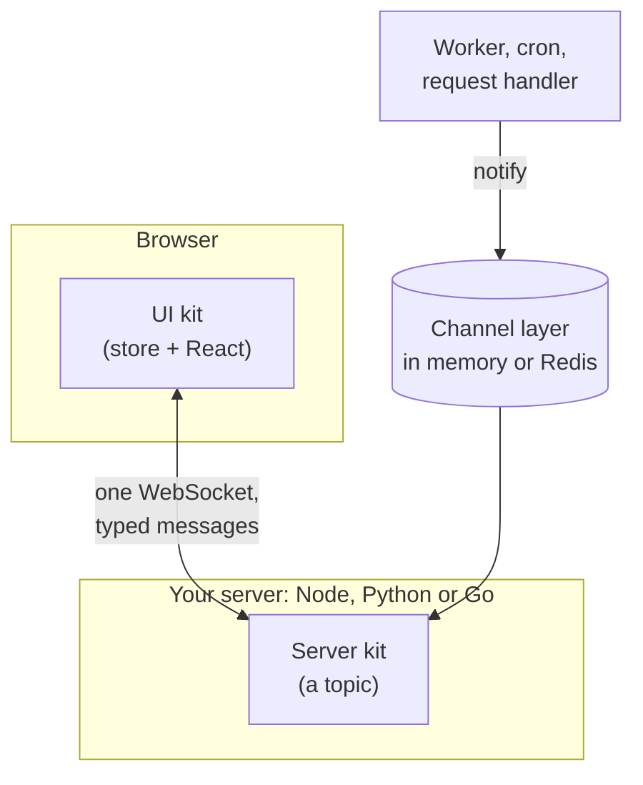

# How it works

A kit is a realtime feature split in two: a server half that runs in your server, and a
browser half that runs in your React app. You copy both into your project; nothing is
installed that you cannot read.

## The pieces

**A topic is what a client subscribes to**, such as `notification:user:42` or
`chat:general`. The server kit is a topic: its own handlers, its own authorization (may
this connection subscribe?), and its own group, so a publish reaches every subscriber.

**One socket carries many kits.** A page subscribes to several topics over one
connection; a chat room and its roster are two kits, side by side.

**Anything can publish.** A worker or request handler publishes to a topic through the
channel layer and never touches a connection. In memory that stays in one process; with
Redis it crosses processes, and servers in different languages share it.

**Both ends agree on every message.** Each feature speaks a versioned **contract**, its
set of messages (`notification@1`). The server documents it as AsyncAPI, the browser's
types are generated from that, and the UI kit binds to the contract rather than to one
server. A Node, Python and Go server speaking `chat@1` serve the same chat UI, and CI
checks every one against the contract.

## Words you will meet

| Term | Meaning |
|---|---|
| Kit | Copied-in source that adds one realtime feature |
| Server kit, UI kit | The server half (a topic) and the browser half (a store with React components) |
| Topic | What a client subscribes to, with its own handlers and authorization |
| Contract | The messages a feature speaks, versioned; UI kits bind to it |
| Provider | A kit that plugs a vendor into a contract, such as Deepgram for speech-to-text |
| Store | Swappable persistence for a kit: in memory by default, Redis or your database |
| Template | A starter app: one server framework plus React, with a kit wired end to end |

## Which servers have which kits

Kits that define a contract a UI kit binds to come to every server: Node, Python and
Go. Stores follow their kit where the service behind them is portable, such as Redis.
Integrations live where their ecosystem is: vendor providers, the Django store and the
pydantic-ai kit are Python. The [catalog](kits/index.md#catalog) shows each kit's
servers.

## Why copy instead of install

Realtime features are built from the same plumbing every time: naming groups,
authorizing each subscriber, sending state on connect, cleaning up on disconnect,
reaching a client from a worker. Rewriting it per project is slow; a framework that does
it for you owns your connections, and the day you need a different authorization rule
you are reading its source for a hook it does not have. A copied kit starts working and
stays yours.

## Under the hood

Kits run on the chanx family: [chanx](https://github.com/chanx-dev/chanx) for Python
(Django Channels and FastAPI), [chanx-go](https://go.chanx.dev/) and
[chanx-js](https://js.chanx.dev/), which speak one protocol. [copit](https://github.com/huynguyengl99/copit)
copies kits in and updates them later. chanx-kit is pronounced "chan-X kit".

## Next

Try it in fifteen minutes with [the tutorial](getting-started.md), or bring it to your own
project: [set up an existing app](set-up-your-app.md).
